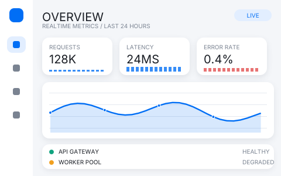
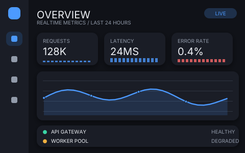
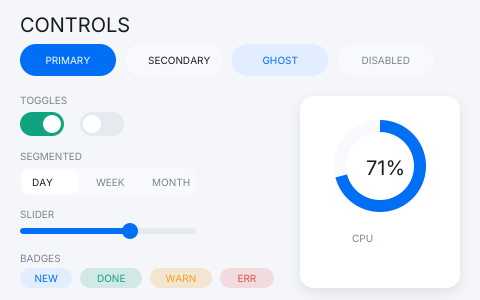
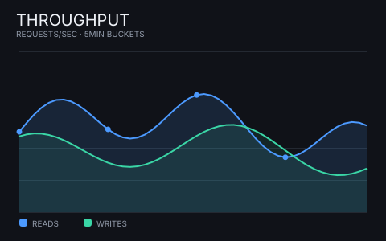
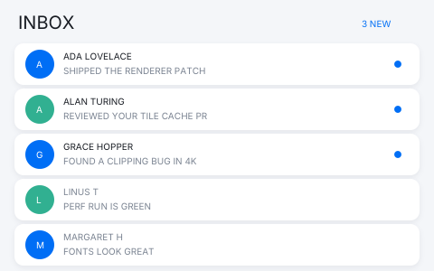
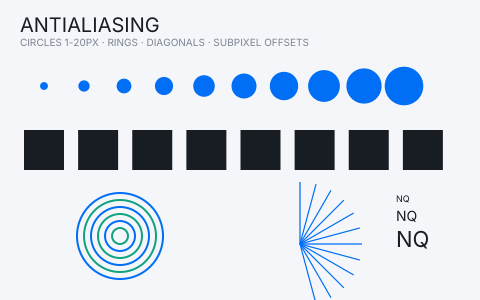
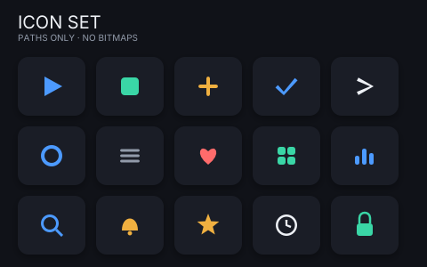
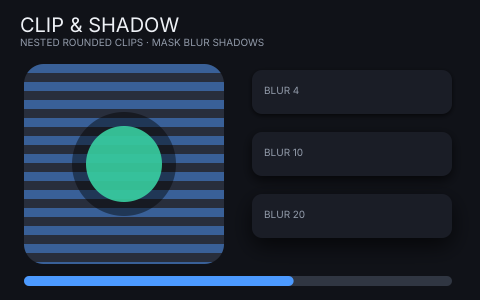

# 11 · Showcase 展厅

> 8 个场景，全部由当前管线渲染：`显示列表 IR → CPU 光栅器 → 预乘合成`。
> 没有任何图片资源、没有第三方库——圆形、圆角、阴影、渐变、文字全部是几何与像素运算。
>
> 文字部分使用**随包 Inter 字体**（SIL OFL）由自研 sfnt 解析器读取轮廓，再走同一条
> 覆盖率光栅路径；因此这里的文字是**真抗锯齿矢量字形**，不是点阵字体。

## 如何生成

```bash
cmake --preset headless && cmake --build --preset headless -j
./build/headless/nq_showcase --out build/headless/showcase     # 输出 .ppm + .png
python3 tools/ppm2png.py build/headless/showcase/*.ppm        # PPM → 压缩 PNG（文档用）
```

每个场景都会打印 `content_hash`：**同一份代码在任何机器上产出相同的哈希与相同的像素**。
这就是 docs/01 §8「确定性」与 docs/08「golden 可断言」的现场证据。

## 场景一览

| 场景 | 展示的设计点 | 用到的能力 |
|------|--------------|-----------|
| `dashboard_light` | 真实业务界面的信息密度 | 圆角卡片 + 投影、渐变面积图、迷你柱状、图例、圆形头像 |
| `dashboard_dark` | 同一套布局切换主题（token 化） | 主题换色，零布局改动 |
| `controls` | 控件视觉规格 | 胶囊按钮、开关、分段控件、滑块、徽章、环形进度（圆弧路径） |
| `chart` | 抗锯齿与半透明叠加 | 折线描边（miter 偏移）、两层半透明面积、网格线 |
| `inbox` | 列表与排版节奏 | 圆形头像、分隔卡、未读点、字距与基线 |
| `aa` | 覆盖率质量本身 | 1–20px 圆形阶梯、同心圆环、非轴对齐细线、亚像素偏移方块、文本缩放阶梯 |
| `icons` | 纯矢量图标（无位图资源） | 三角/圆环/心形（贝塞尔）/星形/铃铛/时钟/锁/网格/放大镜 |
| `clip_shadow` | 裁剪与阴影 | 圆角裁剪（掩码合成）、黑底透出、三档高斯近似阴影、圆角进度条 |

## 逐张解读

### dashboard_light / dashboard_dark



同一份布局函数，只替换 `Theme` 结构体。卡片阴影用「覆盖率掩码 + 三次盒式模糊」实现，
而不是多层 `saveLayer`——这是 docs/02 §6/§7 里相对 Qt/Flutter 的成本优势的最小可运行版本。

### controls


环形进度是**单轮廓圆弧**（外弧正向 + 内弧反向 + 闭合），nonzero 环绕规则自动挖空；
不依赖任何 stroke 光栅特例。滑块、分段控件、徽章全部由圆角矩形与圆形组成。

### chart


折线用「中心线左右偏移成多边形」实现描边，并做过 miter 修正；
两条半透明面积叠加检验预乘 alpha 的合成正确性（不会出现深色描边或过曝）。

### inbox


重点在**排版基线**：1x / 2x 混排时字形的行高与基线对齐，卡片间距保持一致节奏。

### aa


这是质量守门图：
- 1–20px 圆形阶梯：小尺寸不失形，大尺寸边缘平滑；
- 同心圆环：多轮廓 nonzero 挖洞在细宽度下依然干净；
- 非轴对齐细线：验证超采样覆盖率对斜边方向无偏；
- 亚像素偏移方块：面积守恒（偏移不改变覆盖面积，只改变边缘灰阶）；
- 文本缩放阶梯：9/14/22px 真实矢量字形在 4× 亚像素定位下的边缘灰度。

### icons


10 个图标全部由路径构成：三角形、圆角方块、十字、箭头、圆环、三横线、
心形（三次贝塞尔）、四宫格、柱状图、放大镜、铃铛、星形、时钟、锁。
没有任何 SVG/PNG 资源文件。

### clip_shadow


- 圆角裁剪：M0 的显示列表只有矩形裁剪 op，因此圆角裁剪用「先画到临时 surface →
  用 rrect 覆盖率掩码合成」实现；M1 会加入 `PushClipRRect` 原语把它变成零成本。
- 阴影阶梯：BLUR 4 / 10 / 20 三档，验证模糊半径与视觉衰减的关系。

## 与回归体系的关系

- `tests/test_golden.cpp` 用 64×64 的缩小版场景做逐字节 golden 比对（仓库体积可控）。
- `tools/coverage.sh` 会把 8 个场景真实跑一遍作为**集成覆盖**，因此 `src/raster` 中
  每个 opcode 的执行路径都被计入覆盖率，而不是靠"测试里写一遍同样的代码"。
- 每个场景的 `content_hash` 可以贴进 issue 作为像素级复现依据。
